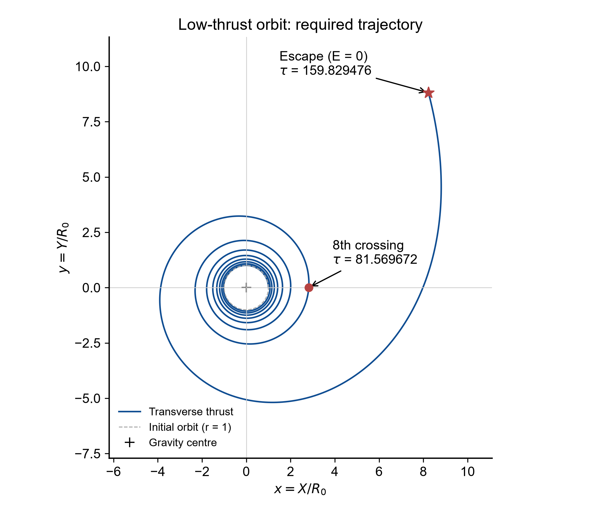
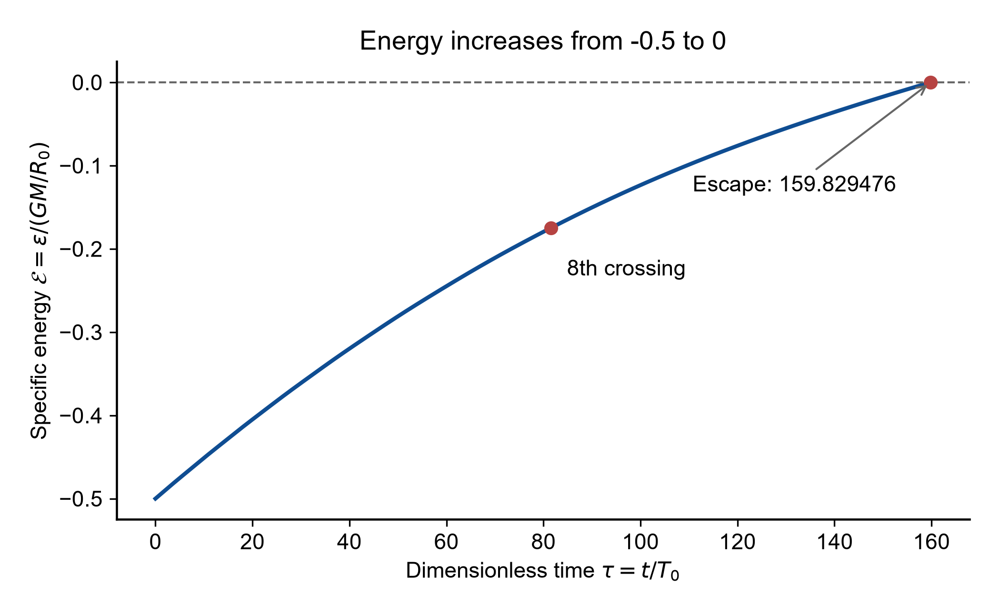
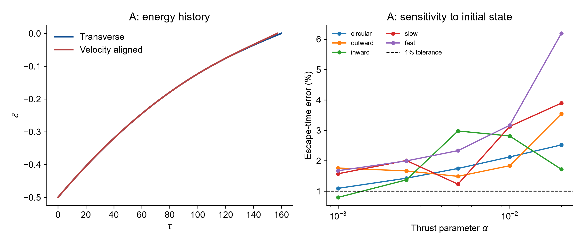

# AAE5210 Miniproject 1: Low Thrust Orbit Simulation

**Course:** AAE5210 Space Vehicle Propulsion Systems · 2026/27 Semester 1  
**Instructor:** Yiqing WANG  
**Student:** XU YUNTAO (许云涛)  
**Student ID:** 26109261g  
**Date:** November 5, 2026

[Download the English report](Report_English.pdf)

This README is the typeset Markdown counterpart of the report. The PDF preserves the handwritten derivation and numerical-method pages.


## 1. Nondimensionalization
Let $\mu=GM$ and define
$$
r=\frac{R}{R_0},\qquad\tau=\frac{t}{T_0},\qquad T_0=\sqrt{\frac{R_0^3}{\mu}}.
$$
Dots denote derivatives with respect to $t$, and primes with respect to $\tau$. Thus,
$$
\dot R=\frac{R_0}{T_0}r',\qquad\ddot R=\frac{R_0}{T_0^2}r'',
$$
$$
\dot\theta=\frac{\theta'}{T_0},\qquad\ddot\theta=\frac{\theta''}{T_0^2}.
$$
Substituting into the radial equation gives
$$
\frac{R_0}{T_0^2}(r''-r\theta'^2)=-\frac{\mu}{R_0^2r^2}.
$$
Dividing by $R_0/T_0^2$ and using $\mu T_0^2/R_0^3=1$, we obtain
$$
r''-r\theta'^2=-\frac{1}{r^2}.
$$
Similarly, substituting $a_\theta=0.005\mu/R_0^2$ into the transverse equation gives
$$
\frac{R_0}{T_0^2}(r\theta''+2r'\theta')=0.005\frac{\mu}{R_0^2},
$$
$$
r\theta''+2r'\theta'=0.005.
$$
The initial angular velocity becomes
$$
\theta'(0)=T_0\sqrt{\frac{\mu}{R_0^3}}=1.
$$
Hence, the dimensionless initial conditions are
$$
r(0)=1,\qquad r'(0)=0,\qquad\theta(0)=0,\qquad\theta'(0)=1.
$$
Scaling the specific mechanical energy by $\mu/R_0$ gives
$$
\mathcal{E}=\frac{\frac{1}{2}[\dot R^2+(R\dot\theta)^2]-\mu/R}{\mu/R_0}
$$
$$
\mathcal{E}=\frac{1}{2}\left[r'^2+(r\theta')^2\right]-\frac{1}{r},\qquad\mathcal{E}(0)=-\frac{1}{2}.
$$


## 2. Numerical method and results
### First-order system
Let $u=r'$ and $\omega=\theta'$. Then
$$
r'=u,\qquad u'=r\omega^2-\frac{1}{r^2},
$$
$$
\theta'=\omega,\qquad\omega'=\frac{0.005-2u\omega}{r}.
$$
The initial state is $(r,u,\theta,\omega)=(1,0,0,1)$. Python's solve_ivp is used with DOP853, relative tolerance $10^{-11}$, absolute tolerance $10^{-13}$, and maximum step $0.2$. Thrust has constant magnitude and remains transverse.
### Eighth positive-axis crossing
The initial position counts as crossing 1. Therefore, crossing 8 occurs at
$$
\theta=2\pi(8-1)=14\pi.
$$
The angle is kept unwrapped. The upward zero of $g_8=\theta-14\pi$ is recorded, and integration continues.
### Escape time
During integration, the specific energy is evaluated as
$$
\mathcal{E}=\frac{1}{2}\left[u^2+(r\omega)^2\right]-\frac{1}{r}.
$$
Integration stops when $\mathcal{E}$ first reaches zero from below. Both event times are located by root finding on the continuous interpolant, rather than estimated from plotted samples.


## 3. Baseline results

### Trajectory





The model assumes constant mass, planar central gravity and continuous transverse acceleration with $\alpha=0.005$. The initial position counts as crossing 1.


Figure 1. Dimensionless trajectory, with the eighth positive-axis crossing and first zero-energy point marked. Axes have equal scale; the dashed circle is the initial orbit.


Thus $t_8=81.569672T_0$ and $t_{\mathrm{esc}}=159.829476T_0$.


### Energy and validation





Figure 2. Specific mechanical energy increases from $-0.5$ to zero. The eighth crossing occurs while $\mathcal{E}=-0.174767313$, so escape has not yet occurred.


At escape, $r=12.055869129$ and $v=0.407301243$. These values satisfy $v=\sqrt{2/r}$, consistent with zero specific energy.


### Numerical convergence


| Method | Relative tolerance | Maximum step | Eighth crossing | Escape |
|---|---|---|---|---|
| DOP853 | 1e-08 | 1.0 | 81.569672 | 159.829476 |
| DOP853 | 1e-10 | 0.5 | 81.569672 | 159.829476 |
| DOP853 | 1e-12 | 0.1 | 81.569672 | 159.829476 |
| RK45 | 1e-11 | 0.1 | 81.569672 | 159.829476 |


The baseline DOP853 run uses relative tolerance $10^{-11}$, absolute tolerance $10^{-13}$, and maximum step $0.2$. Both event times remain unchanged to six decimal places in the table. Independent Cartesian integration also agrees to this precision.


Thrust does work and applies torque: $\mathcal{E}'=\alpha r\omega$ and $(r^2\omega)'=\alpha r$. The integrated work and torque balances have maximum residuals of approximately $3.03\times10^{-15}$ and $9.77\times10^{-15}$.


## 4. Extension A: comparison of thrust directions


The alternative model keeps the same thrust magnitude but directs thrust along the instantaneous velocity. All other assumptions are unchanged.


$$
v=\sqrt{u^2+(r\omega)^2},\qquad a_r=\alpha\frac{u}{v},\qquad a_\theta=\alpha\frac{r\omega}{v}.
$$


$$
r'=u,\quad u'=r\omega^2-\frac{1}{r^2}+a_r,\quad\theta'=\omega,\quad\omega'=\frac{a_\theta-2u\omega}{r}.
$$


The transverse model instead uses $a_r=0$, $a_\theta=\alpha$. The mission objective is escape-time prediction. Taking velocity-aligned thrust as the reference, a 1% relative-error tolerance is selected:


$$
\delta_t=\frac{|\tau_{\mathrm{esc,T}}-\tau_{\mathrm{esc,V}}|}{\tau_{\mathrm{esc,V}}}\leq0.01.
$$


The sweep uses $\alpha\in\{0.001,0.0025,0.005,0.01,0.02\}$. All cases start at $r_0=1$, $\theta_0=0$. The five initial pairs $(u_0,\omega_0)$ are circular: $(0,1)$; outward: $(0.2,1)$; inward: $(-0.2,1)$; slow: $(0,0.9)$; and fast: $(0,1.1)$. All are initially bound.





Figure 3. Left: baseline energy histories, each ending at its own escape time. Right: escape-time error for 25 paired cases; the dashed line is the selected 1% tolerance.


For the prescribed circular case, transverse thrust gives 159.829476, whereas velocity-aligned thrust gives 157.085970. The relative difference is 1.7465%, so the transverse approximation fails the selected 1% objective (but satisfies a 2% objective for this case).


### Findings and reproducibility


### Effect of thrust magnitude and initial state


| Initial state | 0.001 | 0.0025 | 0.005 | 0.01 | 0.02 |
|---|---|---|---|---|---|
| circular | 1.093% | 1.426% | 1.746% | 2.126% | 2.521% |
| outward | 1.761% | 1.666% | 1.487% | 1.837% | 3.542% |
| inward | 0.795% | 1.371% | 2.980% | 2.815% | 1.720% |
| slow | 1.573% | 2.009% | 1.230% | 3.129% | 3.896% |
| fast | 1.673% | 1.995% | 2.334% | 3.167% | 6.189% |


Table. Relative escape-time errors, with columns giving the thrust parameter. Only the inward case at 0.001 meets the 1% criterion among the sampled cases.


For circular initial conditions, the sampled error increases with thrust magnitude. Noncircular initial states show nonmonotonic behaviour, so thrust magnitude alone is not a sufficient acceptance criterion. The table represents discrete cases, not a continuous boundary of validity.


At a common instantaneous state, the energy rates are $\alpha r\omega$ for transverse thrust and $\alpha v$ for velocity-aligned thrust. The directions are locally close when $|u|\ll|r\omega|$. Radial motion becomes important near escape, explaining why an initially circular, low-thrust transfer need not remain within 1% escape-time agreement.


### Conclusion


For the prescribed model, the eighth crossing occurs at 81.569672 and escape at 159.829476 in dimensionless time. The two thrust directions should not be interchanged for a 1% escape-time objective in the baseline case.


### Reproducible program


The accompanying solve.py reproduces the event times, all three figures, the convergence study and the 25 paired extension cases. Install NumPy, SciPy and Matplotlib, then run: python solve.py.


The solver uses continuous event interpolation. It stores the unwrapped angle, records the eighth-crossing event without stopping, and terminates at the first upward zero of energy. The work and torque diagnostic variables do not alter the four dynamical states.


## Run the program

Python 3.11 or later:

```bash
python -m pip install -r requirements.txt
python solve.py
```

The program writes all results into its own directory. It requires no input files or network access after dependency installation.

| File | Contents |
|---|---|
| `Report_English.pdf` | English report with cover and handwritten pages |
| `solve.py` | Numerical solver, checks, parameter sweep and plotting |
| `results.json` | Event times, states, residuals and library versions |
| `trajectory.csv` | Sampled baseline trajectory and energy |
| `crossings.csv` | First eight positive-axis crossings |
| `convergence.csv` | Integrator and tolerance comparison |
| `extension_sweep.csv` | 25 paired thrust-direction comparisons |
| `figure1_trajectory.*` | Required trajectory figure |
| `figure2_energy.*` | Required energy figure |
| `figure3_extension.*` | Extension comparison figure |
| `handwriting/` | Original handwritten pages |
